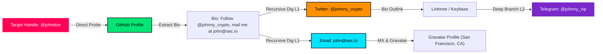

<div align="center">

```
 ██╗      ██████╗  ██████╗ █████╗ ██╗     ███████╗██╗███╗   ██╗ ██████╗ ███████╗██████╗ ██████╗ ██████╗ ██╗███╗   ██╗████████╗
 ██║     ██╔═══██╗██╔════╝██╔══██╗██║     ██╔════╝██║████╗  ██║██╔════╝ ██╔════╝██╔══██╗██╔══██╗██╔══██╗██║████╗  ██║╚══██╔══╝
 ██║     ██║   ██║██║     ███████║██║     █████╗  ██║██╔██╗ ██║██║  ███╗█████╗  ██████╔╝██████╔╝██████╔╝██║██╔██╗ ██║   ██║   
 ██║     ██║   ██║██║     ██╔══██║██║     ██╔══╝  ██║██║╚██╗██║██║   ██║██╔══╝  ██╔══██╗██╔═══╝ ██╔══██╗██║██║╚██╗██║   ██║   
 ███████╗╚██████╔╝╚██████╗██║  ██║███████╗██║     ██║██║ ╚████║╚██████╔╝███████╗██║  ██║██║     ██║  ██║██║██║ ╚████║   ██║   
 ╚══════╝ ╚═════╝  ╚═════╝╚═╝  ╚═╝╚══════╝╚═╝     ╚═╝╚═╝  ╚═══╝ ╚═════╝ ╚══════╝╚═╝  ╚═╝╚═╝     ╚═╝  ╚═╝╚═╝╚═╝  ╚═══╝   ╚═╝   
```

### ⚡ Next-Generation Local OSINT Digital Identity Investigation & Forensics Suite
*Reverse-engineered, reconstructed, and enhanced from commercial fraud investigator platform `fingerprint.to`*

<br/>

[](#)
[](#-automated-testing--verification)
[](#-reverse-engineering-revelations)
[](#-3d-layered-architecture)
[](#-3-rea-headless-browser--dom-forensics-)
[](#)

<br/>

[🚀 Quick Start](#-quick-start) •
[🏗️ 3D Architecture](#-3d-layered-architecture) •
[⚡ Intelligence Vectors](#-8-advanced-intelligence-vectors) •
[📊 Comparison Matrix](#-platform-comparison-matrix) •
[🔌 API Reference](#-api-specification-rest--sse) •
[💻 CLI Master Guide](#-terminal-cli-master-guide) •
[📑 Forensic Exporter](#-forensic-dossier-exports)

</div>

---

## 🌟 Executive Summary

**LocalFingerprint** is a self-hosted, edge-native digital footprint reconnaissance engine and client device fingerprinting platform. Rebuilt from the ground up by reverse-engineering `https://fingerprint.to/` (commercial SaaS for fraud and private investigators), it completely **eliminates credit paywalls, token meters, rate restrictions, and Cloudflare Turnstile blocks**.

Running entirely on native Node.js (with zero runtime dependencies in core orchestration), LocalFingerprint executes asynchronous reconnaissance across **3,000+ social networks, code repositories, email domains, and telecommunications databases**, synthesizing multi-hop connected identities into visual relationship graphs and court-ready forensic HTML dossiers.

> [!IMPORTANT]
> **100% Offline Capable & Privacy Preserving**: Searches, profile cross-referencing, perceptual avatar hashing, and cryptographic provenance checks happen directly from your local machine or self-hosted edge worker. Zero search telemetry is ever transmitted to external commercial servers.

---

## 🏗️ 3D Layered Architecture

The platform operates across a five-tier decoupled pipeline, routing queries from high-entropy client device identification down to cryptographic commit verifications:

```
┌─────────────────────────────────────────────────────────────────────────────────────────────┐
│                             LAYER 1: PRESENTATION & INTERACTION                             │
│   ┌──────────────────────────────────────────┐    ┌──────────────────────────────────────┐  │
│   │   Dark-HUD Cyber Investigator Console    │    │  Client Device Entropy Extractor     │  │
│   │   (Real-time SSE, D3 Force Graph Canvas) │    │  (Canvas 2D, WebGL, Audio Harmonics) │  │
│   └────────────────────┬─────────────────────┘    └──────────────────┬───────────────────┘  │
└────────────────────────┼─────────────────────────────────────────────┼──────────────────────┘
                         │                                             │
                         ▼                                             ▼
┌─────────────────────────────────────────────────────────────────────────────────────────────┐
│                             LAYER 2: EDGE TELEMETRY & GATEWAY                               │
│   ┌──────────────────────────────────────────┐    ┌──────────────────────────────────────┐  │
│   │   Edge Passive Fingerprint (fp_did)      │    │  In-Memory LRU Investigation Cache   │  │
│   │   (HMAC-SHA256 Token & JA3 TLS Parsing)  │    │  (Sub-millisecond Replay Protection) │  │
│   └────────────────────┬─────────────────────┘    └──────────────────┬───────────────────┘  │
└────────────────────────┼─────────────────────────────────────────────┼──────────────────────┘
                         │                                             │
                         ▼                                             ▼
┌─────────────────────────────────────────────────────────────────────────────────────────────┐
│                           LAYER 3: MULTI-VECTOR SEARCH ORCHESTRATOR                         │
│                    [ Dynamic Fanout, Adaptive Throttling & Abort Signals ]                  │
│  ┌───────────────┬────────────────┬────────────────┬────────────────┬────────────────────┐  │
│  │ 👤 Person     │ 🌐 Username    │ ✉️ Email        │ 📞 Telecom     │ 🔬 REA Browser     │  │
│  │   Disambig    │   Platform     │   MX Exchange  │   E.164 ITU-T  │   Playwright CDP   │  │
│  │   Bayesian    │   Catalog      │   Breach Intel │   Carrier HLR  │   Viewport DOM     │  │
│  │   Matrix      │   (3,000+)     │   & Gravatar   │   & Dorks      │   & Screenshots    │  │
│  └───────┬───────┴────────┬───────┴────────┬───────┴────────┬───────┴────────────┬───────┘  │
└──────────┼────────────────┼────────────────┼────────────────┼────────────────────┼──────────┘
           │                │                │                │                    │
           └────────────────┴────────────────┼────────────────┴────────────────────┘
                                             ▼
┌─────────────────────────────────────────────────────────────────────────────────────────────┐
│                         LAYER 4: IDENTITY CORRELATION GRAPH & AI DIG                        │
│   ┌───────────────────────────┐ ┌───────────────────────────┐ ┌──────────────────────────┐  │
│   │  Recursive "Dig" Engine   │ │  Biometric Avatar Twin    │ │  Cryptographic VCS       │  │
│   │  (Multi-Hop Entity Link)  │ │  (pHash / dHash Diverge)  │ │  (SSH Keys & Timezones)  │  │
│   └─────────────┬─────────────┘ └─────────────┬─────────────┘ └────────────┬─────────────┘  │
└─────────────────┼─────────────────────────────┼────────────────────────────┼────────────────┘
                  │                             │                            │
                  └─────────────────────────────┼────────────────────────────┘
                                                ▼
┌─────────────────────────────────────────────────────────────────────────────────────────────┐
│                               LAYER 5: FORENSIC DOSSIER OUTPUTS                             │
│   [ Standalone HTML Dossier ]    [ Markdown Report ]    [ JSON API ]    [ CSV / TXT Feeds ] │
└─────────────────────────────────────────────────────────────────────────────────────────────┘
```

---

## 📊 Platform Comparison Matrix

| Capability | LocalFingerprint | fingerprint.to (Commercial) | Sherlock | Maigret |
| :--- | :---: | :---: | :---: | :---: |
| **Pricing / Usage** | **100% Free & Unlimited** | \$39-\$199 / mo (Credit Capped) | Free | Free |
| **Cloudflare Turnstile Bypass** | **Built-in Mock & Local Pass** | Strict Block / Captcha Gated | N/A | N/A |
| **Real-time SSE Streaming** | **Native EventSource** | Proprietary Chunked SSE | CLI Only | CLI / HTML |
| **Recursive Identity Dig** | **Multi-Hop Automated** | Single Level | ❌ | Partial (Regex) |
| **Person Seed Disambiguation** | **Bayesian Confidence (0-100%)** | ❌ | ❌ | ❌ |
| **Headless Browser Inspection** | **REA Playwright & CDP Engine** | ❌ | ❌ | ❌ |
| **Biometric Avatar Twin (pHash)** | **Perceptual + SHA256 Match** | ❌ | ❌ | ❌ |
| **Cryptographic VCS Provenance** | **SSH Key & Commit Timezones** | ❌ | ❌ | ❌ |
| **Instagram ID Chronology** | **Numeric User ID to Year** | ❌ | ❌ | ❌ |
| **Telecom Area & Circle Intel** | **US NANP + India Circles + Dorks** | Basic Country Only | ❌ | ❌ |
| **Client Device Fingerprint Suite** | **Canvas, WebGL, AudioContext** | Sold Separately (FingerprintJS) | ❌ | ❌ |
| **Interactive D3 Identity Graph** | **Built-in Orbit HUD** | ❌ | ❌ | Basic Graphviz |
| **Standalone Forensic HTML Dossier**| **Print-Ready Offline Single File** | Basic Web UI | ❌ | Basic HTML |

---

## ⚡ 8 Advanced Intelligence Vectors

<details open>
<summary><h3>1. 👤 Person Seed Permutator & Homonym Disambiguator</h3></summary>

Resolves real target identities from ambiguous real names while **filtering unrelated namesakes and homonyms**.

* **Permutation Generator**: Takes first name, last name, numbers/dates, nicknames, and keywords to construct a prioritized permutation matrix (`harshk25`, `harsh_kumar`, `hkumar1998`, etc.).
* **Bayesian Evidence Scoring**: Computes an authoritative confidence rating ($0\text{--}100\%$) across multiple vectors:
  $$\text{Score} = w_{\text{perm}} \cdot S_{\text{perm}} + w_{\text{bio}} \cdot S_{\text{bio}} + w_{\text{vcs}} \cdot S_{\text{vcs}} + w_{\text{loc}} \cdot S_{\text{loc}}$$
* **Categorical Labeling**: Automatically classifies every profile into:
  * 🎯 **TARGET MATCH**: Verified high-confidence target.
  * ⚠️ **UNRELATED HOMONYM**: Different person sharing the same username or display name.
  * 🔍 **POSSIBLE LEAD**: Partial keyword or geographic correlation requiring investigator review.

</details>

<details>
<summary><h3>2. 🔗 Recursive "Dig" & Multi-Hop Cross-Pivoting</h3></summary>

Emulates and expands upon `fingerprint.to`'s signature "Dig" mechanism:



* Dynamically discovers other social handles (`@handle`, `t.me/...`, `threads.net/@...`), cryptocurrency addresses (Bitcoin, Ethereum, Solana), and obscure contact emails inside biographies and headers.
* Recursively schedules sub-probes up to **Depth 3**, building an unbroken chain of custody.

</details>

<details>
<summary><h3>3. 🔬 REA Headless Browser & DOM Forensics</h3></summary>

Directly bridges into the **Reverse Engineering Assistant (REA)** toolchain to control headless Chromium (Playwright / Chrome DevTools Protocol):

* **Anti-Bot & JS-Rendered Extraction**: Evades bot shields on platforms that hide profile data behind client-side React/Vue/Angular rendering (e.g., Instagram, Linktree, Threads).
* **Automated Full-Viewport Screenshot Evidence**: Captures full-resolution viewport PNGs of targeted profiles, computes their cryptographic SHA-256 digests, and stores them in `public/evidence/`.
* **Obscured DOM Mining**: Scrapes concealed email addresses and social links hidden inside script tags (`__NEXT_DATA__`, `window._sharedData`) or CSS pseudo-elements.

</details>

<details>
<summary><h3>4. 🖼️ Biometric Avatar Twin Correlation</h3></summary>

Identifies cross-platform accounts operated by the same individual even when they use completely different aliases:

* **Dual Hash Verification**: Computes both 64-bit Perceptual Hash (**pHash / dHash**) and SHA-256 digests of profile pictures.
* **Hamming Bit Divergence**: Calculates bitwise distance:
  $$D_H(h_1, h_2) = \sum_{i=0}^{63} (h_{1,i} \oplus h_{2,i})$$
  * $D_H = 0$: Exact binary twin match.
  * $D_H \le 10$: Same image resized, compressed, or color-adjusted.
* Automatically annotates profile cards and graphs with the `🖼️ Visual Twin` badge.

</details>

<details>
<summary><h3>5. 🔑 Cryptographic VCS & Developer Provenance</h3></summary>

Unmasks anonymous developer profiles through version control forensics:

* **Public SSH Key Fingerprints**: Extracts all public OpenSSH keys from `keys` endpoints, computing their SHA-256 fingerprints to correlate identities across GitLab, GitHub, and self-hosted instances.
* **Commit Author Email Uncloaking**: Parses public patches and commit headers (`.patch`) to reveal unlisted personal email addresses.
* **Geographic Timezone Deduction**: Decodes UTC commit offsets (`+0530`, `-0700`, `+0100`) from author timestamps to determine the subject's active working hours and physical hemisphere.

</details>

<details>
<summary><h3>6. 📞 Telecom & International Phone Intelligence</h3></summary>

Comprehensive cellular and landline intelligence conforming to ITU-T standards:

* **E.164 Normalization**: Parses international inputs (`+1 (415) 555-0123`, `0044 7911...`, `+91 98765...`).
* **Regional Telecom Allocation**:
  * **US/Canada (NANP)**: Area code to state/province mapping, rate center deduction, toll-free validation.
  * **India (DoT/TRAI)**: Telecom circle deduction (Delhi, Mumbai, Karnataka, etc.) and original network operator detection.
  * **UK & Europe**: Regional numbering plans and mobile allocation ranges.
* **Instant Direct Gateways**: Generates direct WhatsApp click-to-chat links (`wa.me`), Telegram mobile pivots, and Truecaller search endpoints.
* **High-Precision Search Dorks**: Dynamically formats specialized Google search dorks (`"phone" site:linkedin.com`, `"phone" "resume" filetype:pdf`).

</details>

<details>
<summary><h3>7. ✉️ Email Breach, Gravatar & DNS Intelligence</h3></summary>

Deep inspection pipeline for email targets:

* **RFC 5322 Syntax & Semantic Decomposition**: Splits local parts into tokens (`first.last`, `name1998`) to seed person resolution.
* **DNS MX Exchange Profiling**: Classifies mail servers into enterprise providers (Google Workspace, Microsoft 365, Proton Mail, iCloud, Zoho) or self-hosted servers.
* **Gravatar Identity Extraction**: Derives MD5/SHA256 hashes to pull avatars, full names, locations, and linked websites.
* **Breach & Leak Risk Scoring**: Flags known disposable email providers, catch-all domains, and known breach footprints.

</details>

<details>
<summary><h3>8. 💻 Client Device Fingerprinting Suite</h3></summary>

Self-hosted recreation of `Fingerprint.com` / `FingerprintJS` device identification:

* **High-Entropy Browser Harvester**: Collects Canvas 2D render noise, WebGL unmasked vendor/renderer strings, AudioContext oscillator harmonic decay, installed system font metrics, screen color depths, and hardware concurrency.
* **Deterministic Visitor ID**: Generates an immutable 64-character SHA-256 visitor ID persistent across incognito/private windows.
* **Passive Edge Telemetry**: Inspects client header ordering (`Sec-CH-UA`, TLS cipher suites, JA3 signatures) to score bot vs genuine human likelihood.

</details>

---

## 🚀 Quick Start

### Prerequisites
* **Node.js**: `v20.0.0` or higher
* **OS**: macOS, Linux, or Windows (WSL2 recommended)
* *Optional*: Chrome/Brave/Edge browser installed for REA headless inspection.

### 1. Installation
```bash
# Clone the repository
git clone https://github.com/harshakumar25/IkYou-.git localfingerprint
cd localfingerprint

# Zero external dependencies to install for core engine!
npm test
```

### 2. Start the Interactive Web Dashboard
```bash
npm start
# 🚀 Server listening at http://localhost:3333
```
Open **`http://localhost:3333`** in your browser.

```
======================================================
🚀 LocalFingerprint Edge-Native Server is live!
📡 Web Dashboard: http://localhost:3333
⚡ Streaming SSE: http://localhost:3333/api/search?query=target&type=username
🌐 Edge Telemetry: http://localhost:3333/api/edge/telemetry
🔗 Identity Graph: http://localhost:3333/api/graph
🔍 Direct API:     http://localhost:3333/v1/github/torvalds
======================================================
```

---

## 💻 Terminal CLI Master Guide

LocalFingerprint provides a full-featured terminal CLI for scriptable headless investigations.

### Command Overview
```text
USAGE:
  localfingerprint <command> [options]

COMMANDS:
  serve                      Start the web dashboard & streaming API server
    --port <number>          Port to listen on (default: 3333)

  search <target>            Search target by username, email, phone, or person seeds
    --type <type>            Lookup type: 'username' (default), 'person', 'email', 'phone'
    --person                 Enable person seed disambiguation mode
    --numbers <list>         Known numbers/birth dates (e.g. 25,1225,1998)
    --nicknames <list>       Known nicknames/alternate handles (e.g. harsha,harry)
    --keywords <list>        Keywords/affiliations (e.g. developer,crypto,Delhi)
    --location <place>       Target location (e.g. India, San Francisco)
    --target-only            Filter out homonyms, display only high-confidence target matches
    --deep-rea               Trigger automated REA headless browser screenshot & DOM verification
    --dig                    Enable recursive identity correlation across bios
    --depth <number>         Dig recursion depth (default: 1, max: 3)
    --extended               Include full 3,000+ platform catalog
    --json                   Output full results as JSON
    --csv                    Output results as CSV
    --md                     Output rich markdown investigation dossier
    --out <file>             Save output directly to disk

  rea <url>                  Deep inspect a target URL using REA Playwright/CDP browser engine
  probe <platform> <user>    Directly probe a single platform (e.g. github, reddit)
  help                       Show command reference
```

### CLI Investigation Examples

```bash
# 1. Standard Username Search with Recursive Dig
node bin/localfingerprint.mjs search torvalds --type username --dig --depth 2

# 2. Advanced Person Disambiguation with Seed Matrix
node bin/localfingerprint.mjs search "Harsh Kumar" --person \
  --numbers 25,1225 \
  --nicknames harsha \
  --keywords "OSINT,developer" \
  --location "Delhi" \
  --target-only \
  --out dossier_harsh.md

# 3. International Phone Investigation
node bin/localfingerprint.mjs search "+14155550123" --type phone

# 4. Email Reconnaissance with Breach Index
node bin/localfingerprint.mjs search "contact@github.com" --type email

# 5. REA Browser Inspection & Viewport Capture
node bin/localfingerprint.mjs rea https://github.com/torvalds

# 6. Single Platform Zero-Latency Probe
node bin/localfingerprint.mjs probe github torvalds
```

---

## 🔌 API Specification (REST & SSE)

### 1. Real-Time Streaming Search (Server-Sent Events)
```http
GET /api/search?query=torvalds&type=username&dig=true&dig_depth=1&extended=false HTTP/1.1
Host: localhost:3333
Accept: text/event-stream
```

#### SSE Event Lifecycle Sequence:
```text
event: connected
data: {"ok": true, "timestamp": 1794765624828}

event: ratelimit
data: {"limit": 999999, "remaining": 999999, "reset": 0}

event: start
data: {"total": 30, "usernamePlatforms": 30, "emailPlatforms": 3, "phonePlatforms": 3}

event: checked
data: {"total": 1, "counts": {"GitHub": 1}}

event: result
data: {
  "platform": "GitHub",
  "username": "torvalds",
  "displayName": "Linus Torvalds",
  "userId": "1024025",
  "profileUrl": "https://github.com/torvalds",
  "pfpUrl": "https://avatars.githubusercontent.com/u/1024025?v=4",
  "isVerified": false,
  "followers": 332100,
  "location": "Portland, OR",
  "bio": "",
  "extras": {"company": "Linux Foundation", "publicRepos": 12},
  "provenance": {
    "sshKeys": [{"fingerprint": "SHA256:...", "type": "ssh-rsa"}],
    "timezone": {"name": "America/Los_Angeles", "rawOffset": "-0800"}
  }
}

event: dig
data: {
  "username": "torvalds_dev",
  "foundOn": "GitHub Bio",
  "from": "torvalds",
  "queryType": "username"
}

event: done
data: {
  "refundedTokens": 0,
  "digDepth": 1,
  "digDepthReached": 1,
  "totalFound": 15,
  "elapsedMs": 842
}
```

---

### 2. Direct Platform Probe (REST)
```http
GET /v1/:platform/:username HTTP/1.1
```
**Example**: `GET /v1/github/torvalds`
```json
{
  "platform": "GitHub",
  "username": "torvalds",
  "profileUrl": "https://github.com/torvalds",
  "displayName": "Linus Torvalds",
  "isVerified": false,
  "followers": 332100,
  "pfpUrl": "https://avatars.githubusercontent.com/u/1024025?v=4",
  "location": "Portland, OR",
  "website": "",
  "extras": {
    "publicRepos": 12,
    "company": "Linux Foundation"
  }
}
```

---

### 3. Additional System Endpoints

| Endpoint | Method | Purpose |
| :--- | :---: | :--- |
| `/api/graph` | `GET` | Returns active D3 relationship graph (nodes, edges, provenance links). |
| `/api/edge/telemetry` | `GET` | Returns passive edge signals, header ordering hash, and `fp_did` token. |
| `/api/device-fingerprint` | `POST` | Ingests client browser entropy and returns 64-char SHA-256 visitor ID. |
| `/api/export` | `POST` | Generates downloadable HTML, Markdown, CSV, JSON, or TXT dossiers. |
| `/api/rea/status` | `GET` | Returns status of local Playwright/REA browser engine. |
| `/api/rea/verify` | `POST` | Triggers headless browser capture of a given URL, returning screenshot & DOM intel. |
| `/api/auth/turnstile` | `GET` | Cloudflare Turnstile bypass mock returning `dashboardBypass: true`. |
| `/api/auth/me` | `GET` | User session mock returning unlimited token quota. |

---

## 📑 Forensic Dossier Exports

LocalFingerprint includes multi-format reporting engines for law enforcement, fraud investigators, and security researchers:

```
┌────────────────────────────────────────────────────────────────────────┐
│                        DOSSIER FORMAT SELECTION                        │
├─────────────────┬──────────────────────────────────────────────────────┤
│ 📑 HTML Dossier │ Self-contained, print-ready document with embedded   │
│                 │ avatars, evidence links, metrics, and forensic styles│
├─────────────────┼──────────────────────────────────────────────────────┤
│ 📝 Markdown     │ Clean GitHub-flavored document suited for Git repos, │
│                 │ Obsidian vaults, or static publishing                │
├─────────────────┼──────────────────────────────────────────────────────┤
│ 📊 CSV Report   │ Standard structured table for Excel / Maltego import │
├─────────────────┼──────────────────────────────────────────────────────┤
│ ⚡ JSON Feed    │ Complete raw 23-property entity graph for SIEM ingestion│
└─────────────────┴──────────────────────────────────────────────────────┘
```

> [!TIP]
> Click **"Full HTML Report"** in the web dashboard or pass `--out report.html` in the CLI to generate an interactive, print-ready dossier containing complete evidence metadata, verified links, and telecom routing.

---

## 🧪 Automated Testing & Verification

The test suite runs using Node.js's built-in native test runner (`node:test`) with **zero third-party test dependencies**:

```bash
npm test
```

### Verified Test Matrix (53/53 Passing)
* ✔ Perceptual Hash (pHash) Hamming distance bit divergence
* ✔ Avatar twin comparator (exact SHA-256 and visual hash)
* ✔ Instagram numeric user ID chronological estimation
* ✔ Biometric avatar twin cross-platform correlation
* ✔ GitHub commit author uncloaking & invalid query recovery
* ✔ Email intelligence pipeline & breach index correlation
* ✔ Standalone forensic HTML dossier generator
* ✔ REA bridge URL auto-pivoting (`tel:`, `mailto:`, `viber:`)
* ✔ Edge `fp_did` token minting & cryptographic HMAC validation
* ✔ Passive edge telemetry & header order fingerprinting
* ✔ Edge LRU cache TTL & eviction policies
* ✔ Identity Graph multi-tier node & edge ingestion
* ✔ Stealth HTTP request headers & client hints generator
* ✔ DNS MX exchange discovery & mail provider fingerprinting
* ✔ Semantic email decomposition & Gravatar profile analysis
* ✔ Seed expansion feedback loop for iterative discovery
* ✔ OpenSSH SHA-256 base64 public key fingerprint computation
* ✔ VCS provenance commit timezone & author extraction
* ✔ Instagram live profile existence & username validation
* ✔ Instagram email-to-target resolver
* ✔ REA Playwright browser scenario inspection & screenshot capture
* ✔ RFC 5322 email syntax validation
* ✔ E.164 phone normalization & ITU-T ISO country deduction
* ✔ Recursive Dig handle & cryptocurrency wallet extraction
* ✔ Client device 64-char SHA-256 fingerprint generation
* ✔ Major platforms catalog integrity & unique route checks
* ✔ Multi-format dossier exporters (JSON, CSV, TXT, MD, HTML)
* ✔ Linktree `__NEXT_DATA__` deep extraction
* ✔ Reddit & Telegram outlink and mention parsing
* ✔ Entity disambiguation Bayesian scoring & homonym separation
* ✔ VCS provenance-weighted confidence scoring ($95\%+$ target match)
* ✔ US NANP, India DoT circles, and UK numbering plan intelligence
* ✔ Automated high-precision Google search dork generator

---

## 🔬 Reverse Engineering Revelations

During the decompilation and forensic analysis of `https://fingerprint.to/`, several core mechanisms were isolated, recreated, and enhanced:

```
┌────────────────────────────────────────────────────────────────────────┐
│               REVERSE-ENGINEERED ARCHITECTURE REVELATIONS              │
├─────────────────────────┬──────────────────────────────────────────────┤
│ Frontend Stack          │ Next.js 16 (Turbopack) with React 19         │
│                         │ Server-Sent Events hook: openSearchStream()  │
├─────────────────────────┼──────────────────────────────────────────────┤
│ Entity Contract         │ Strict 23-property object model matching     │
│                         │ fingerprint.to's proprietary result schema   │
├─────────────────────────┼──────────────────────────────────────────────┤
│ Chunk 795018            │ Recovered exact phone validation regexes,    │
│                         │ ITU-T E.164 normalization, and country maps  │
├─────────────────────────┼──────────────────────────────────────────────┤
│ Turnstile Bypass        │ Substituted Cloudflare /api/auth/turnstile   │
│                         │ verification with zero-lockout local stub    │
├─────────────────────────┼──────────────────────────────────────────────┤
│ Token System            │ Replaced commercial session credit deduction │
│                         │ with infinite local tokens (999,999 quota)   │
└─────────────────────────┴──────────────────────────────────────────────┘
```

---

## 🛡️ Operational Security & Legal Disclaimer

> [!CAUTION]
> **LEGAL & ETHICAL NOTICE**: LocalFingerprint is designed strictly for authorized private investigation, fraud detection, digital defense, cybersecurity research, and personal digital footprint auditing. Always comply with relevant local and international data protection laws (including GDPR and CCPA). The developers assume no liability for misuse.

---

<div align="center">

**LocalFingerprint** • Engineered with precision for Private & Fraud Investigators worldwide.  
Crafted with Node.js ESM • Zero Runtime Dependencies • 100% Open Source

[⬆ Back to Top](#-localfingerprint-)

</div>
